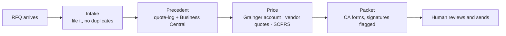

<p align="center">
  
  
  
  
</p>

# Black Box Safety — Claude Marketplace

**How a nine-person government distributor runs its sales desk and storefront with Claude,
packaged so every machine works the same way on the same rules.**

## The company, in one paragraph

Black Box Safety, Inc. sells safety, tactical, and MRO equipment to government buyers: California
state agencies (CDCR, CalFire, CalTrans, DSH, CalVet), federal primes (Bechtel, USACE), and local
fire and law enforcement. Service-disabled-veteran owned, El Cajon, California, founded 2017.
Contract vehicles include NASPO MRO, the California Body Armor LPA, Sourcewell, GSA MAS, and
NPPGov. The work arrives as inbound RFQs. The bottleneck has never been selling skill; it is the
sourcing labor between "RFQ received" and "compliant quote sent." This repo moves that labor to
Claude and keeps people on the two decisions that need judgment: what to promise a buyer, and
what to send.

## What this repo is

The canon. One place holds everything a BBS machine needs to do the job the BBS way:

- **Plugins** (skills, agents, commands, hooks) for the quote desk, the storefront, and the
  company-wide doctrine every skill inherits.
- **Managed settings** the admin pushes from the Claude console: permissions, guardrails, the
  company memory every session starts with.
- **The rep workspace**: a VS Code workspace pointed at the shared quote-desk folder tree.
- **Operating docs**: setup guides, runbook, metrics, registry of what is canon and what is
  archived.

Push to `main` and every registered machine picks it up. Nothing is copied between computers.
Nothing drifts.

## Pick your path

| You are | Start here | Time |
|---|---|---|
| New to any of this | [`docs/TOOLKIT.md`](docs/TOOLKIT.md) — what the tools are, in plain words, and how to extend them | ~10 min read |
| A sales rep | [`docs/REP-SETUP.md`](docs/REP-SETUP.md), then `/bbs-checkup` | ~20 min, once |
| The admin | [`docs/ADMIN-RUNBOOK.md`](docs/ADMIN-RUNBOOK.md) §0 → §3a | One morning |
| Maintaining the website | [`plugins/bbs-website/README.md`](plugins/bbs-website/README.md), then `/bbs-onboard` | ~15 min |
| Changing a skill | [`plugins/bbs-website/docs/CONTRIBUTING.md`](plugins/bbs-website/docs/CONTRIBUTING.md) and the [design spec](docs/superpowers/specs/2026-09-11-rep-workspace-rollout-design.md) | As needed |

## Sixty-second install

```text
/plugin marketplace add Black-Box-Safety/bbs-claude-marketplace
/plugin install bbs-foundations@bbs-claude-marketplace
/plugin install bbs-claude-coach@bbs-claude-marketplace
/plugin install bbs-sales@bbs-claude-marketplace
/plugin install bbs-back-office@bbs-claude-marketplace
/plugin install bbs-website@bbs-claude-marketplace
/bbs-onboard
/bbs-checkup
/bbs-what-can-i-do
```

On a managed machine the plugins are already enabled; run the last two lines and read the
report. Anything red prints the exact sentence to send the admin.

## What a quote looks like now

> **Rep:** CDCR at Mule Creek just sent an RFQ for 40 cases of nitrile gloves and two confined-space
> blowers. Log it and price it.
>
> **Claude:** Filed under `CDCR (ALL)/Mule Creek State Prison/` — no duplicate buyer folder, checked
> by name and by item. Last quoted this buyer gloves in March at $Y (won). Gloves are NASPO: Grainger
> price against Mule Creek's own account. Blowers are not on any schedule, so this is a competitive
> lane with the 5% SB preference; drafting vendor outreach for two suppliers. Packet B forms filled,
> signed on the lines Parker owns. Every number is in the cover summary with its source. Ready for your review.

The rep reviews every number. The rep sends. Claude cannot.



## The plugins

| Plugin | What it covers | Detail |
|---|---|---|
| `bbs-claude-coach` | Empowerment / literacy: understand the toolkit, start any overlapping job, extend it; `/bbs-what-can-i-do`, `/bbs-start`, `/bbs-explain-claude` | [README](plugins/bbs-claude-coach/README.md) |
| `bbs-sales` | The California quote desk end to end: RFQ in, items extracted, BPO checked, priced, quoted, compliance packet filled — plus promo pages and federal deck copy; `/ca-rfq-log`, `/ca-rfq-quote` | [README](plugins/bbs-sales/README.md) |
| `bbs-back-office` | After the bid is won, out of Business Central: order status, vendor PO receipts, problem-order reconciliation, true margin after Grainger rebates | [README](plugins/bbs-back-office/README.md) |
| `bbs-foundations` | Company memory, doctrine every skill inherits, the BBS way to write a CLAUDE.md, personal voice skills, `/bbs-checkup`, managed settings, the one-page AUP | [README](plugins/bbs-foundations/README.md) |
| `bbs-website` | The storefront: price list to product page across the database, Shopify, and the quote bot | [README](plugins/bbs-website/README.md) |
| `claudeforge` | Pinned external CLAUDE.md engine used by `bbs-foundations` | [fork](https://github.com/Black-Box-Safety/ClaudeForge) |
| `impeccable` | Pinned external design skill for anything with a frontend | [fork](https://github.com/Black-Box-Safety/impeccable) |
| `superpowers-chrome` · `caveman` · `document-skills` | **Commons**: pinned third-party plugins reps get by default — real-Chrome browsing, opt-in terse mode, Anthropic's Word/PDF/Excel skills | [docs/COMMONS.md](docs/COMMONS.md) |

## The rules that never bend

These are enforced in settings and doctrine, not left to memory.

- **Claude drafts; a human sends.** Send-class email and e-signature tools are denied by managed
  policy. Every quote, price, and form is a draft until a rep reviews it.
- **Never an invented number.** No price, stock, lead time, or certification fact from memory or the
  open web. Unknown becomes `[FLAG: why]`, never a guess.
- **Certification language follows the channel.** SDVOSB for federal and primes; OSDS SB/DVBE
  2009473 for California state. Never mixed.
- **Systems of record win.** Business Central for money, Supabase for the catalog, SharePoint for
  documents. Point at the record; never re-type it.
- **When it goes wrong, log it.** One line in the folder's `FLAGS.md`. A caught error means the
  review worked. Monthly triage turns entries into skill fixes.

## What it will not do

Place orders. Send anything. Write to Business Central. Rename a customer folder (account numbers
ride on the names). Invent a price. It searches, files, drafts, prices from real sources, fills
forms, and tells you where every number came from. The judgment stays with the person.

## Repo layout

```text
bbs-claude-marketplace/
├── .claude-plugin/marketplace.json     # manifest: 5 BBS plugins (unpinned) + 5 external (pinned)
├── README.md                           # this file
├── REGISTRY.md                         # every BBS repo and asset: canon, harvest, parked, archived
├── workspace/                          # bbs-rep.code-workspace + desk CLAUDE.md template
├── docs/
│   ├── REP-SETUP.md · ADMIN-RUNBOOK.md · ADMIN-CLEANUP.md · MEASUREMENT.md · TOOLKIT.md
│   ├── acceptance/                     # one file per pilot gate run
│   ├── assessments/                    # what we found, dated
│   └── superpowers/                    # design specs and implementation plans
└── plugins/
    ├── bbs-claude-coach/               # literacy coach: understand, start, extend
    ├── bbs-foundations/                # commands, docs (managed settings, AUP), hooks, skills
    ├── bbs-sales/                      # commands, skills
    ├── bbs-back-office/                # skills
    └── bbs-website/                    # agents, commands, docs, hooks, skills
```

## How we keep it honest

- **Version policy:** the five BBS plugins carry no version pin. Every push updates every machine.
  Freeze only for a pilot, then unfreeze.
- **Registry:** [`REGISTRY.md`](REGISTRY.md) gives every repo and asset exactly one status. Change
  the status in the same commit as the change.
- **Measurement:** [`docs/MEASUREMENT.md`](docs/MEASUREMENT.md) — four inbound numbers (capacity),
  four outbound (growth), a baseline captured before anything is claimed.
- **Acceptance:** a rep who is not the admin runs a real RFQ end to end, unaided. Result recorded in
  [`docs/acceptance/`](docs/acceptance/README.md). That is the definition of done.
- **Models:** `claude-opus-5` · `claude-sonnet-5` · `claude-haiku-4-5` only, generated from
  `plugins/bbs-foundations/skills/bbs-claude-md-forge/references/models.json`. Anything else is
  stale.

## Contributing

Scope a change to one skill or one stage. Write the acceptance criterion before the change. Run the
plugin's validation (`claude plugin validate .` and the plugin directory). Commit with a
conventional message. Never push a model update and a skill update the same week. Details in
[`CONTRIBUTING.md`](plugins/bbs-website/docs/CONTRIBUTING.md).

---

<sub>Maintained by Black Box Safety, Inc. · DVBE/SDVOSB government distributor · El Cajon, CA ·
Internal use. No single point of failure by design.</sub>
