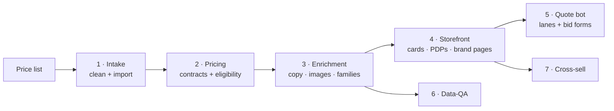

<p align="center">
  
  
  
</p>

# BBS Ops

This marketplace ships three plugins, split by the desk that owns the work. This README
covers **bbs-ops**, the one that maintains the website: everything from a manufacturer's
price list to a live product page. The other two have their own READMEs — **bbs-sales**
is the California state quote desk, and **bbs-back-office** is what happens after the bid
is won. Install whichever matches your job; install more than one if you do more than one.

bbs-ops covers three repos that together make one storefront: the product **database**, the
**Shopify** store, and the customer-facing **quote bot**. Install it once and Claude knows how
BBS does each job, the same way every time. No one person has to hold it all in their head.

**Jump to:** [Plugins in this marketplace](#plugins-in-this-marketplace) · [See it work](#see-it-work) · [Use it](#using-it-team-start-here) · [Set it up](#setting-it-up-admins) · [What you can do](#what-you-can-do) · [What's inside](#whats-inside) · [Limits](#what-it-wont-do) · [Docs](#documentation) · [Technical details](#for-developers)

## Plugins in this marketplace

| Plugin | Covers | Who installs it | README |
|---|---|---|---|
| `bbs-sales` | The CA state quote desk end to end: RFQ in, items extracted, BPO checked, priced, quoted, compliance packet filled. Plus promo pages and federal deck copy. | Sales reps | [plugins/bbs-sales/README.md](plugins/bbs-sales/README.md) |
| `bbs-ops` | Maintaining the website: price list to product page, across the database, Shopify, and the quote bot. | Whoever maintains the site | This file |
| `bbs-back-office` | After the bid is won, out of Business Central: order status, vendor PO receipts, true margin after Grainger rebates. | Purchasing, accounting, anyone answering "where is it?" | [plugins/bbs-back-office/README.md](plugins/bbs-back-office/README.md) |

The rest of this README is about `bbs-ops` specifically.

## See it work

> **You:** We just got a price list from Avon Protection. Get it into the store.
>
> **Claude:** Cleaning the list into the BBS import template (17 SKUs), loading it into the products database, and checking Avon's contract eligibility (they're on NPPGov PS25650, so contract pricing applies). Enriching descriptions and images, then building the Avon brand page in the Field Manual style like the other 24. Last step: a "Customers Also Bought" strip so the new gear surfaces next to related items.

One request walks the whole pipeline. Each step is owned by an agent that knows the BBS way of doing it, and the rules (pricing, certifications, design) apply automatically whether or not you've read them.

## Using it (team, start here)

Once it's installed, there's nothing to configure:

1. Open the repo in Claude Code (CLI, the VS Code extension, or Desktop).
2. Run **`/bbs-onboard`**. It walks you through the pipeline and the agent roster.
3. It points you at **`site-wiring-map`**, the single "how it all connects" reference.
4. Try a real task: *"Add a product,"* *"Build a brand page for Streamlight,"* or *"Why is the Supply lane showing too many options?"*

You should be able to upload one product and see it render as a card and PDP without asking anyone. The [onboarding guide](plugins/bbs-ops/docs/ONBOARDING.md) has more.

## Setting it up (admins)

One person adds the marketplace once; the whole team installs from it and stays current through git.

```bash
# add the marketplace (one time)
/plugin marketplace add Black-Box-Safety/bbs-claude-marketplace

# install what matches the job
/plugin install bbs-sales@bbs-claude-marketplace         # sales reps
/plugin install bbs-ops@bbs-claude-marketplace           # site maintenance
/plugin install bbs-back-office@bbs-claude-marketplace   # purchasing / accounting

# wire the guardrails and learn the layout (bbs-ops)
/bbs-onboard
```

Updating later is `/plugin marketplace update`: new skill and agent versions arrive through git, so nobody copies files between machines and nothing drifts.

## What you can do

- **Load a new price list**: *"Clean this Damascus price sheet and import it."*
- **Apply a contract**: *"Load the new Sourcewell discounts by manufacturer."*
- **Onboard a manufacturer**: *"Add a brand page for Avon, like the others."*
- **Fix the storefront**: *"This product card is missing its logo and shows the wrong price mode."*
- **Tune the quote bot**: *"The Direct lane isn't recommending the right brands."*
- **Merchandise**: *"Add a Customers-Also-Bought strip to the PDPs."*
- **Audit quality**: *"Find products with broken images or descriptions that don't match."*

## What's inside

| | |
|---|---|
| Pipeline stages | **7**: intake, pricing, enrichment, storefront, quote bot, data-QA, cross-sell |
| Agents | **10**: one owner per stage, plus Arthur (architecture), Tom (delivery), business-review |
| Skills | Catalog import pipeline, price-list cleaning, contract pricing, variant families, product pages, brand pages, image pipeline, lane tuning, and `site-wiring-map` |
| Commands | `/bbs-onboard` · `/bbs-add-product` · `/bbs-new-brand` · `/bbs-review` |
| Guardrails | Skill-bus doctrine that auto-applies BBS design, cert, pricing, and grounding rules |
| Repos covered | `bbs-database` · `bbs-shopify` · `bbs-quote-bot` |



## What it won't do

It doesn't replace the three repos or run the site: it's how you *maintain* them. The quote bot it tunes is advisory: it searches, recommends, quotes, and generates forms, but it never places orders or writes to Business Central on its own. And it's honest by design: the bot states only facts from the database and knowledge files, never invented prices or stock. Sanity-check any number before it goes to a customer, same as any tool.

## Documentation

| Guide | Who it's for |
|---|---|
| [ONBOARDING](plugins/bbs-ops/docs/ONBOARDING.md) | Anyone new to maintaining the site |
| [site-wiring-map](plugins/bbs-ops/skills/site-wiring-map/SKILL.md) | The "how it all connects" reference |
| [CONTRIBUTING](plugins/bbs-ops/docs/CONTRIBUTING.md) | Changing or adding a skill/agent |
| [plugins/bbs-ops](plugins/bbs-ops/README.md) | The plugin's own detailed README |

## For developers

<details>
<summary>How it's built, the layout, and the quick start</summary>

### Layout

```
bbs-claude-marketplace/
├── .claude-plugin/marketplace.json   # marketplace manifest, lists every plugin
├── README.md                         # this file
└── plugins/
    ├── bbs-ops/
    │   ├── .claude-plugin/plugin.json
    │   ├── skills/                   # one folder per skill, each with SKILL.md
    │   ├── agents/                   # one file per agent
    │   ├── commands/                 # /bbs-onboard, /bbs-add-product, …
    │   └── docs/                     # onboarding + contributor guides
    ├── bbs-sales/                    # same shape: plugin.json + skills/, no agents/commands yet
    └── bbs-back-office/              # same shape: plugin.json + skills/
```

### How the pieces fit

- **Skills** teach the BBS way of each task; **agents** own a pipeline stage and route work to the right skill; **commands** are thin orchestration over both.
- **Two data planes, one product truth**: the Supabase products database (`bbs-database`) is the source, Shopify renders it, and the quote bot advises over a frozen snapshot plus live search. A database change reaches the storefront only after sync, and the bot only after a `gen-*.mjs` regen is committed.
- **Docs teach, the skill-bus enforces**: three doctrine inserts (storefront design/cert/pricing, catalog rules, quote-bot grounding) auto-inject as context whenever a relevant skill runs, so the rules hold even for someone who hasn't read them. `/bbs-review` reads `skill-bus-telemetry.jsonl` to catch coverage gaps.
- **Reviewers keep it living**: Arthur (architecture) and Tom (delivery/quality) review recent changes and write findings back into the skills, so the plugin sharpens like the site does.
- **Reference skills are linked, not copied**: generic Shopify/Liquid skills update on their own and never drift.

### Quick start (contributor)

```bash
git clone https://github.com/Black-Box-Safety/bbs-claude-marketplace
cd bbs-claude-marketplace
# add it as a local marketplace to test before pushing
/plugin marketplace add ./
/plugin install bbs-ops@bbs-claude-marketplace
/bbs-review        # run Arthur + Tom against your changes before shipping
```

**Model IDs (current only):** `claude-opus-4-8` · `claude-sonnet-5` · `claude-haiku-4-5`. Anything referencing a dated or older suffix is stale. Fix it.

</details>

---

<sub>Maintained by the Black Box Safety team, DVBE/SDVOSB government distributor, El Cajon, CA. No single point of failure by design. Design & plans in `docs/superpowers/`.</sub>
