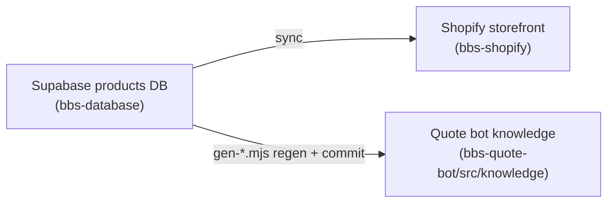

# BBS Ops Plugin Implementation Plan

> **For agentic workers:** REQUIRED SUB-SKILL: Use superpowers:subagent-driven-development (recommended) or superpowers:executing-plans to implement this plan task-by-task. Steps use checkbox (`- [ ]`) syntax for tracking.

**Goal:** Ship the `bbs-ops` Claude Code plugin — consolidated BBS site-maintenance skills, responsibility-named agents, onboarding commands, and a skill-bus enforcement layer — distributed from one `Black-Box-Safety/bbs-claude-marketplace` marketplace, so any team member can maintain the site without depending on Parker.

**Architecture:** A new git repo `bbs-claude-marketplace` holds a marketplace manifest and one plugin, `plugins/bbs-ops/`. Skills are **copied** (not cut) from three source repos + global `~/.claude/skills` so originals keep working during validation. Agents are authored fresh with responsibility names, composed from the existing agent bodies. Three skill-bus doctrine inserts auto-inject BBS rules when relevant skills run. The marketplace manifest carries two plugin slots from day one (`bbs-ops` now, `bbs-foundations` later) so the sibling plugin is an append, not a refactor.

**Tech Stack:** Claude Code plugin format (`.claude-plugin/plugin.json`, `.claude-plugin/marketplace.json`), Markdown skills/agents/commands, skill-bus (`.claude/skill-bus.json`), git.

**Boundary decisions locked (Arthur):**
1. Skills reference an MCP by **stable server/tool name only** and **degrade gracefully** when it is absent — a missing MCP downgrades a skill, never errors the session.
2. `bbs-grounding-doctrine` is marked **"migrates to bbs-foundations"** — ops may seed it; foundations owns the final home.
3. `marketplace.json` declares **both** plugin entries from day one (`bbs-ops` live, `bbs-foundations` as a documented placeholder).
4. Migration cutover is **per-skill**, after validation — never an en-masse delete.

**Verification gate (Tom):** A Black Box team member who is not Parker, guided only by `/bbs-onboard` + `site-wiring-map`, uploads one product and sees it render as a card + PDP — Parker not in the loop. Plus: zero `no_match` for any `bbs-ops:*` skill in `skill-bus-telemetry.jsonl`.

---

## File Structure

Repo root: `c:\Users\Parker-BBS\bbs-claude-marketplace` (sibling of the three working repos).

```
bbs-claude-marketplace/
├── .claude-plugin/
│   └── marketplace.json                  # two plugin entries (bbs-ops, bbs-foundations placeholder)
├── README.md                             # from docs/plugin-readmes/README-marketplace.md
└── plugins/
    └── bbs-ops/
        ├── .claude-plugin/plugin.json    # plugin manifest
        ├── README.md                     # from docs/plugin-readmes/README-bbs-ops.md
        ├── skills/
        │   ├── price-list-cleaner/SKILL.md
        │   ├── contract-discount-loader/SKILL.md
        │   ├── family-rollup/SKILL.md (+ references/)
        │   ├── image-pipeline/SKILL.md            # NEW stub
        │   ├── product-page/SKILL.md
        │   ├── brand-page-builder/SKILL.md
        │   ├── le-lane-tuning/SKILL.md
        │   ├── supply-lane-tuning/SKILL.md
        │   ├── ca-form-filler/SKILL.md
        │   ├── obs-form-filler/ (SKILL.md + assets/ references/ scripts/)
        │   ├── bbs-sourcing/SKILL.md
        │   └── site-wiring-map/SKILL.md           # NEW keystone
        ├── agents/
        │   ├── catalog-intake.md                  # NEW (from database-troubleshooter + price-list intake)
        │   ├── pricing-contracts.md               # NEW (from contract-discount-loader domain)
        │   ├── product-enrichment.md              # NEW (from product-enrichment-auditor + family-rollup)
        │   ├── storefront-pages.md                # NEW (from product-page/brand-page skills)
        │   ├── quote-bot.md                       # NEW (folds scout + quincy + response-tuner)
        │   ├── data-qa.md                         # NEW (from database-troubleshooter + enrichment-auditor)
        │   ├── cross-sell.md                      # from docs/plugin-agents/cross-sell.md
        │   ├── arthur.md                          # from docs/plugin-agents/arthur.md
        │   ├── tom.md                             # from docs/plugin-agents/tom.md
        │   └── business-review.md                 # from bbs-quote-bot vera.md, renamed
        ├── commands/
        │   ├── bbs-onboard.md
        │   ├── bbs-add-product.md
        │   ├── bbs-new-brand.md
        │   └── bbs-review.md
        ├── hooks/
        │   └── skill-bus.json                     # 3 doctrine inserts + subscriptions
        └── docs/
            ├── ONBOARDING.md
            └── CONTRIBUTING.md
```

Source paths (copy from):
- `c:\Users\Parker-BBS\bbs-database\.claude\skills\bbs-price-list-cleaner\SKILL.md`
- `c:\Users\Parker-BBS\bbs-database\.claude\skills\bbs-contract-discount-loader\SKILL.md`
- `bbs-family-rollup` — on branch `feature/nonapparel-family-expansion` in `bbs-database` (`.claude/skills/bbs-family-rollup/` — SKILL.md + references/rule-authoring.md)
- `c:\Users\Parker-BBS\bbs-shopify\.claude\skills\bbs-product-page\SKILL.md`
- `c:\Users\Parker-BBS\bbs-shopify\.claude\skills\brand-page-builder\SKILL.md`
- `c:\Users\Parker-BBS\bbs-quote-bot\.claude\skills\le-lane-tuning\SKILL.md`
- `c:\Users\Parker-BBS\bbs-quote-bot\.claude\skills\supply-lane-tuning\SKILL.md`
- `c:\Users\Parker-BBS\.claude\skills\ca-form-filler\SKILL.md`
- `c:\Users\Parker-BBS\.claude\skills\obs-form-filler\` (whole tree)
- `c:\Users\Parker-BBS\.claude\skills\bbs-sourcing\SKILL.md`
- Agent drafts: `c:\Users\Parker-BBS\bbs-quote-bot\docs\plugin-agents\{arthur,tom,cross-sell}.md`
- `business-review` from `c:\Users\Parker-BBS\bbs-quote-bot\.claude\agents\vera.md`
- Source agents to compose from: `bbs-quote-bot\.claude\agents\{scout,quincy,response-tuner}.md`, `bbs-database\.claude\agents\{database-troubleshooter,product-enrichment-auditor}.md`
- READMEs: `c:\Users\Parker-BBS\bbs-quote-bot\docs\plugin-readmes\README-{marketplace,bbs-ops}.md`
- Doctrine source: `c:\Users\Parker-BBS\bbs-shopify\.claude\skill-bus.json` (the `bbs-storefront-doctrine` insert)

---

## Phase 0 — Repo skeleton + manifests

### Task 1: Initialize the plugin repo

**Files:**
- Create: `c:\Users\Parker-BBS\bbs-claude-marketplace\.gitignore`

- [ ] **Step 1: Create the repo and directory tree**

```bash
cd /c/Users/Parker-BBS
mkdir -p bbs-claude-marketplace/.claude-plugin
mkdir -p bbs-claude-marketplace/plugins/bbs-ops/{.claude-plugin,skills,agents,commands,hooks,docs}
cd bbs-claude-marketplace
git init -b main
printf 'node_modules/\n.DS_Store\n*.log\nskill-bus-telemetry.jsonl\n' > .gitignore
```

- [ ] **Step 2: Verify tree**

Run: `find /c/Users/Parker-BBS/bbs-claude-marketplace -type d | sort`
Expected: the directories above, no errors.

- [ ] **Step 3: Commit**

```bash
git add .gitignore && git commit -m "chore: init bbs-claude-marketplace repo skeleton"
```

### Task 2: Marketplace manifest (two plugin slots)

**Files:**
- Create: `bbs-claude-marketplace/.claude-plugin/marketplace.json`

- [ ] **Step 1: Write the manifest**

```json
{
  "name": "bbs-claude-marketplace",
  "owner": { "name": "Black Box Safety, Inc." },
  "metadata": {
    "description": "Black Box Safety internal Claude plugins — site operations and AI foundations.",
    "version": "0.1.0"
  },
  "plugins": [
    {
      "name": "bbs-ops",
      "source": "./plugins/bbs-ops",
      "description": "Maintain the BBS website end to end — price list to product page. Skills, agents, and commands for catalog intake, pricing, enrichment, storefront, quote bot, QA, and cross-sell.",
      "version": "0.1.0",
      "author": { "name": "Black Box Safety, Inc." },
      "keywords": ["bbs", "shopify", "supabase", "quote-bot", "catalog", "operations"],
      "category": "operations"
    }
  ]
}
```

> **Note (boundary decision 3):** `bbs-foundations` is intentionally NOT yet a plugin entry — adding a non-existent `source` path breaks marketplace load. The slot is reserved by documentation (see the placeholder comment task below), and the entry is appended in the bbs-foundations plan once its `plugins/bbs-foundations/` directory exists.

- [ ] **Step 2: Record the reserved sibling slot**

Create `bbs-claude-marketplace/.claude-plugin/PLUGINS.md`:

```markdown
# Plugins in this marketplace

- **bbs-ops** (live) — site-maintenance pipeline. `plugins/bbs-ops`.
- **bbs-foundations** (planned, separate spec) — company-wide AI fundamentals: MCP connectors
  (ca-procurement-intel, Grainger, BBS KIt, Microsoft 365, Shopify, Supabase), shared company
  knowledge, and AI-literacy onboarding. When built, append a second entry to
  `marketplace.json` with `"source": "./plugins/bbs-foundations"`.
```

- [ ] **Step 3: Validate JSON**

Run: `node -e "JSON.parse(require('fs').readFileSync('.claude-plugin/marketplace.json','utf8')); console.log('ok')"`
Expected: `ok`

- [ ] **Step 4: Commit**

```bash
git add .claude-plugin/ && git commit -m "feat: marketplace manifest (bbs-ops live, bbs-foundations reserved)"
```

### Task 3: Plugin manifest

**Files:**
- Create: `bbs-claude-marketplace/plugins/bbs-ops/.claude-plugin/plugin.json`

- [ ] **Step 1: Write the manifest**

```json
{
  "name": "bbs-ops",
  "description": "Maintain the BBS website end to end — price list to product page. Consolidated skills, responsibility-named agents, onboarding commands, and skill-bus doctrine that keeps BBS design, cert, pricing, and grounding rules consistent.",
  "version": "0.1.0",
  "author": { "name": "Black Box Safety, Inc." },
  "keywords": ["bbs", "shopify", "supabase", "quote-bot", "catalog", "operations"],
  "skills": "./skills/",
  "hooks": { "paths": ["./hooks/skill-bus.json"] }
}
```

> Agents in `./agents/` and commands in `./commands/` are auto-discovered by directory convention; they do not need manifest entries.

- [ ] **Step 2: Validate JSON**

Run: `node -e "JSON.parse(require('fs').readFileSync('plugins/bbs-ops/.claude-plugin/plugin.json','utf8')); console.log('ok')"`
Expected: `ok`

- [ ] **Step 3: Commit**

```bash
git add plugins/bbs-ops/.claude-plugin/ && git commit -m "feat(bbs-ops): plugin manifest"
```

---

## Phase 1 — Keystone: site-wiring-map skill

### Task 4: Author the site-wiring-map skill

**Files:**
- Create: `plugins/bbs-ops/skills/site-wiring-map/SKILL.md`

- [ ] **Step 1: Write the skill**

````markdown
---
name: site-wiring-map
description: The single "how the BBS website is wired" reference — which repo holds what, where product data lives, how it flows from the Supabase database through Shopify to the quote bot, and for each common task which skill and which agent to use. Use when onboarding, when unsure which repo or skill a change belongs in, or when a change must cross repos (a DB field that must reach both the storefront and the bot).
---

# BBS Site Wiring Map

Read this first. It is the front door to maintaining the BBS website.

## Three repos, one product truth

- **`bbs-database`** — the source of truth. Supabase Postgres `products` (+ `manufacturers`,
  `categories`), the ETL import pipeline, the contract-pricing subsystem (discount-off-MSRP by
  manufacturer, per contract), Firecrawl enrichment, variant-family rollups, and BC sync.
- **`bbs-shopify`** — the storefront. The "Field Manual" theme, product cards/PDPs, ~24 brand
  pages, `brand.*` + product metafields, the Supabase→Shopify sync, and the Sirv image CDN.
- **`bbs-quote-bot`** — the customer-facing quote + forms bot. React/Vite SPA
  (`src/components/BBSQuoteFormsBot.jsx`), Claude via the `/api/anthropic` proxy → Vercel AI
  Gateway, advisor knowledge in `src/knowledge/` (frozen snapshots of the DB, built by
  `scripts/gen-*.mjs`), CA form generators in `src/forms/`.

## How data flows (and the two gaps that trip people)



- A DB change does **not** appear on the storefront until the **Supabase→Shopify sync** runs.
- A DB change does **not** reach the bot until a **`gen-*.mjs` regen is run and committed**.
Forgetting either is the most common "why isn't my change showing up" cause.

## For each task: which skill, which agent

| I want to… | Skill | Agent |
|---|---|---|
| Clean/import a manufacturer price list | `price-list-cleaner` | `catalog-intake` |
| Apply/refresh a contract's discounts | `contract-discount-loader` | `pricing-contracts` |
| Build a variant family | `family-rollup` | `product-enrichment` |
| Fix/enrich descriptions or images | `image-pipeline` | `product-enrichment` |
| Change a product card or PDP | `product-page` | `storefront-pages` |
| Add a manufacturer brand page | `brand-page-builder` | `storefront-pages` |
| Tune the LE (Direct) lane | `le-lane-tuning` | `quote-bot` |
| Tune the Grainger (Supply) lane | `supply-lane-tuning` | `quote-bot` |
| Fill CA / CDCR bid forms | `ca-form-filler` / `obs-form-filler` | `quote-bot` |
| Source an RFQ from vendors | `bbs-sourcing` | `quote-bot` |
| Add "Customers Also Bought" | (uses `product-page`) | `cross-sell` |
| Audit data quality | — | `data-qa` |
| Review architecture of a change | — | `arthur` |
| Review delivery/quality of a change | — | `tom` |
| Judge customer value of a change | — | `business-review` |

## External services (provided by the bbs-foundations plugin, referenced here)

The bot and these skills **reference** MCP connectors by name; they are provided by the
`bbs-foundations` plugin, not bundled here. If a connector is not installed, the referencing
skill **degrades gracefully** (it says the live lookup is unavailable and proceeds with what it
has) — it never errors the session. Connectors: Grainger MCP, BBS KIt, Microsoft 365, Shopify,
Supabase, ca-procurement-intel.

## The rules that always hold

The skill-bus injects three doctrine sets automatically (storefront, catalog, grounding) when a
relevant skill runs — see the plugin README. You do not have to memorize them; you do have to
not fight them.
````

- [ ] **Step 2: Verify frontmatter parses**

Run: `node -e "const s=require('fs').readFileSync('plugins/bbs-ops/skills/site-wiring-map/SKILL.md','utf8'); if(!s.startsWith('---')) throw 'no frontmatter'; console.log('ok')"`
Expected: `ok`

- [ ] **Step 3: Commit**

```bash
git add plugins/bbs-ops/skills/site-wiring-map/ && git commit -m "feat(bbs-ops): site-wiring-map keystone skill"
```

---

## Phase 2 — Port pipeline skills (copy, don't cut)

Each ported skill is copied verbatim, then gets a one-line pipeline-stage header added under its
frontmatter so the reader always knows where they are. Originals are untouched.

### Task 5: Copy the single-file skills

**Files:**
- Create: 8 skill folders under `plugins/bbs-ops/skills/`

- [ ] **Step 1: Copy each source SKILL.md into place**

```bash
cd /c/Users/Parker-BBS/bbs-claude-marketplace
QB=/c/Users/Parker-BBS/bbs-quote-bot
DB=/c/Users/Parker-BBS/bbs-database
SH=/c/Users/Parker-BBS/bbs-shopify
GL=/c/Users/Parker-BBS/.claude/skills
S=plugins/bbs-ops/skills

mkdir -p $S/price-list-cleaner $S/contract-discount-loader $S/product-page \
         $S/brand-page-builder $S/le-lane-tuning $S/supply-lane-tuning \
         $S/ca-form-filler $S/bbs-sourcing

cp "$DB/.claude/skills/bbs-price-list-cleaner/SKILL.md"        $S/price-list-cleaner/SKILL.md
cp "$DB/.claude/skills/bbs-contract-discount-loader/SKILL.md"  $S/contract-discount-loader/SKILL.md
cp "$SH/.claude/skills/bbs-product-page/SKILL.md"              $S/product-page/SKILL.md
cp "$SH/.claude/skills/brand-page-builder/SKILL.md"            $S/brand-page-builder/SKILL.md
cp "$QB/.claude/skills/le-lane-tuning/SKILL.md"                $S/le-lane-tuning/SKILL.md
cp "$QB/.claude/skills/supply-lane-tuning/SKILL.md"            $S/supply-lane-tuning/SKILL.md
cp "$GL/ca-form-filler/SKILL.md"                               $S/ca-form-filler/SKILL.md
cp "$GL/bbs-sourcing/SKILL.md"                                 $S/bbs-sourcing/SKILL.md
```

- [ ] **Step 2: Copy the multi-file obs-form-filler tree**

```bash
cp -r "$GL/obs-form-filler" $S/obs-form-filler
```

- [ ] **Step 3: Verify every skill has a SKILL.md**

Run: `for d in $S/*/; do test -f "$d/SKILL.md" && echo "ok $d" || echo "MISSING $d"; done`
Expected: `ok` for all; no `MISSING`.

- [ ] **Step 4: Commit**

```bash
git add plugins/bbs-ops/skills/ && git commit -m "feat(bbs-ops): port single- and multi-file pipeline skills (copy)"
```

### Task 6: Port family-rollup from its branch

**Files:**
- Create: `plugins/bbs-ops/skills/family-rollup/` (SKILL.md + references/rule-authoring.md)

- [ ] **Step 1: Extract the skill from the bbs-database branch without switching branches**

```bash
cd /c/Users/Parker-BBS/bbs-database
git show feature/nonapparel-family-expansion:.claude/skills/bbs-family-rollup/SKILL.md \
  > /tmp/family-SKILL.md
git show feature/nonapparel-family-expansion:.claude/skills/bbs-family-rollup/references/rule-authoring.md \
  > /tmp/family-rules.md
```

- [ ] **Step 2: Place them in the plugin**

```bash
cd /c/Users/Parker-BBS/bbs-claude-marketplace
mkdir -p plugins/bbs-ops/skills/family-rollup/references
cp /tmp/family-SKILL.md plugins/bbs-ops/skills/family-rollup/SKILL.md
cp /tmp/family-rules.md plugins/bbs-ops/skills/family-rollup/references/rule-authoring.md
```

- [ ] **Step 3: Verify**

Run: `test -f plugins/bbs-ops/skills/family-rollup/SKILL.md && test -f plugins/bbs-ops/skills/family-rollup/references/rule-authoring.md && echo ok`
Expected: `ok`

- [ ] **Step 4: Commit**

```bash
git add plugins/bbs-ops/skills/family-rollup/ && git commit -m "feat(bbs-ops): port family-rollup skill from branch"
```

### Task 7: Add pipeline-stage headers + fix hardcoded paths

Each ported skill gets a stage header line, and any hardcoded absolute path (e.g. `~/bbs-database`)
is softened to a repo-relative instruction so the skill works from any machine.

**Files:**
- Modify: each `plugins/bbs-ops/skills/*/SKILL.md`

- [ ] **Step 1: Insert a stage header under the frontmatter of each ported skill**

For each skill, add this line as the first line of the body (immediately after the closing `---`
of the frontmatter), with the correct stage:

```markdown
> **BBS Ops pipeline — stage: <STAGE>.** See `site-wiring-map` for how this fits the whole flow.
```

Stage values: price-list-cleaner → `Intake`; contract-discount-loader → `Pricing`;
family-rollup → `Enrichment`; product-page, brand-page-builder → `Storefront`;
le-lane-tuning, supply-lane-tuning, ca-form-filler, obs-form-filler, bbs-sourcing → `Quote bot`.

- [ ] **Step 2: Soften hardcoded machine paths**

Run to find them: `grep -rn "~/bbs-\|/c/Users/Parker" plugins/bbs-ops/skills/ || echo "none"`
For each hit, replace the absolute path with a relative instruction, e.g. change
`operates inside the ~/bbs-database repo` → `operates inside the bbs-database repo (locate it
with the site-wiring-map; do not assume an absolute path)`.

- [ ] **Step 3: Verify no absolute user paths remain**

Run: `grep -rn "/c/Users/Parker\|C:\\\\Users\\\\Parker" plugins/bbs-ops/skills/ && echo "FOUND" || echo "clean"`
Expected: `clean`

- [ ] **Step 4: Commit**

```bash
git add plugins/bbs-ops/skills/ && git commit -m "docs(bbs-ops): add pipeline-stage headers; remove machine-specific paths"
```

### Task 8: image-pipeline stub skill

The `image-optimization`/`sirv-*` dirs in bbs-shopify are empty; author a documented stub so the
stage exists and the wiring map is honest.

**Files:**
- Create: `plugins/bbs-ops/skills/image-pipeline/SKILL.md`

- [ ] **Step 1: Write the stub**

````markdown
---
name: image-pipeline
description: Prepare and place BBS product/brand imagery — scrape or receive source images, optimize, push to the Sirv CDN, and wire the resulting URLs into Supabase product image fields and Shopify metafields. Use when a product has no image, an image is broken or wrong, or a new brand needs a hero/logo. NOTE: this workflow is being formalized; follow the documented steps and record any gap for /bbs-review.
---

> **BBS Ops pipeline — stage: Enrichment.** See `site-wiring-map`.

# Image Pipeline (forming)

This skill is a documented stub. The CDN workflow (Sirv) and enrichment scraping (Firecrawl)
exist in practice but are not yet a single codified skill. Until they are:

1. **Source** — obtain the manufacturer image (supplier import, or Firecrawl scrape of the
   manufacturer product page). Reference the Firecrawl MCP by name; if it is not installed,
   fall back to a manual image hand-off and note it.
2. **Optimize** — size/compress to the storefront's card and PDP dimensions.
3. **Host** — upload to the Sirv CDN; capture the canonical URL.
4. **Wire** — write the URL to the Supabase product image field (so both the storefront and the
   quote-bot `image_url` fallback pick it up) and, for brands, the `brand.*` hero/logo metafield.

**Known gap:** codify steps 1–3 as a script under `bbs-database`/`bbs-shopify` and replace this
stub. Log the gap for `/bbs-review` so Arthur/Tom prioritize it.
````

- [ ] **Step 2: Commit**

```bash
git add plugins/bbs-ops/skills/image-pipeline/ && git commit -m "feat(bbs-ops): image-pipeline stub skill (Enrichment stage)"
```

---

## Phase 3 — Agents

Drafted agents (arthur, tom, cross-sell) are moved verbatim. Pipeline-stage agents are authored
fresh with responsibility names, composing content from the existing agent bodies.

### Task 9: Place the drafted + renamed agents

**Files:**
- Create: `plugins/bbs-ops/agents/{arthur,tom,cross-sell,business-review}.md`

- [ ] **Step 1: Copy the three committed drafts**

```bash
cd /c/Users/Parker-BBS/bbs-claude-marketplace
QB=/c/Users/Parker-BBS/bbs-quote-bot
cp "$QB/docs/plugin-agents/arthur.md"     plugins/bbs-ops/agents/arthur.md
cp "$QB/docs/plugin-agents/tom.md"        plugins/bbs-ops/agents/tom.md
cp "$QB/docs/plugin-agents/cross-sell.md" plugins/bbs-ops/agents/cross-sell.md
```

- [ ] **Step 2: Create business-review from vera, renamed**

```bash
cp "$QB/.claude/agents/vera.md" plugins/bbs-ops/agents/business-review.md
```

Then edit `plugins/bbs-ops/agents/business-review.md` frontmatter: change `name: vera` to
`name: business-review` and prepend "Business-vision reviewer (formerly 'Vera')" to the
description's first sentence. Leave the body unchanged.

- [ ] **Step 3: Verify each has a name field matching its filename**

Run:
```bash
for f in arthur tom cross-sell business-review; do
  grep -q "^name: $f" plugins/bbs-ops/agents/$f.md && echo "ok $f" || echo "MISMATCH $f"
done
```
Expected: `ok` for all four.

- [ ] **Step 4: Commit**

```bash
git add plugins/bbs-ops/agents/ && git commit -m "feat(bbs-ops): add arthur, tom, cross-sell, business-review agents"
```

### Task 10: Author `quote-bot` agent (folds scout + quincy + response-tuner)

**Files:**
- Create: `plugins/bbs-ops/agents/quote-bot.md`
- Read for source material: `bbs-quote-bot/.claude/agents/{scout,quincy,response-tuner}.md`

- [ ] **Step 1: Write the agent**

Frontmatter exactly:

```markdown
---
name: quote-bot
description: Owner of the BBS customer-facing quote + forms bot (both lanes). Use for any change to the Direct lane (LE, manufacturer-direct, track "direct"/"nppgov", PS25650 — discovery, brand recommendations, search ranking, knowledge, browse tiles), the Supply lane (Grainger MRO resale, track "supply", NASPO MRO LPA — few-options/one-pick, pricing/availability, quote math, CA/CDCR bid packets), and the shared chat platform (the /api/anthropic proxy, Vercel AI Gateway, model routing/escalation, /api/log, prompt scaffolding, and the eval/regression harness). Grounded in le-lane-tuning and supply-lane-tuning.
model: inherit
---
```

Body must include these sections, composed from the source agents (read them first, then write
in one consistent voice — do not paste three prompts back to back):

1. **Identity** — you own both lanes and the shared plumbing of `src/components/BBSQuoteFormsBot.jsx`.
2. **Direct lane** (from `scout.md`) — discovery for LE officers; findability, preferred brands,
   search ranking, `src/knowledge/` files; verify end-to-end.
3. **Supply lane** (from `quincy.md`) — Grainger few-options/one-pick quoting; money-bearing code
   discipline; the complete CA bid packet (quote page 1 + STD 204 + PD 843 + GSPD + Darfur +
   STD 1000 + CalRecycle when physical goods).
4. **Shared platform** (from `response-tuner.md`) — the measure→diagnose→smallest-fix→verify loop;
   `MODELS = { fast: "claude-haiku-4-5", specialist: "claude-sonnet-5" }`; `escalate_to_specialist`;
   `/api/anthropic` proxy + gateway; `/api/log` logging; eval harness (`src/lib/*.eval.test.js`).
5. **Grounding + gates** — states only tool/knowledge facts; forms at session end only; signature
   lines flagged; CalRecycle perjury cert needs rep confirm; DVBE expiry checked.
6. **Escalation** — hand architecture calls to `arthur`, delivery/quality to `tom`, customer-value
   to `business-review`.

- [ ] **Step 2: Verify**

Run: `grep -q "^name: quote-bot" plugins/bbs-ops/agents/quote-bot.md && echo ok`
Expected: `ok`

- [ ] **Step 3: Commit**

```bash
git add plugins/bbs-ops/agents/quote-bot.md && git commit -m "feat(bbs-ops): quote-bot agent (folds scout + quincy + response-tuner)"
```

### Task 11: Author the four data/catalog/storefront agents

**Files:**
- Create: `plugins/bbs-ops/agents/{catalog-intake,pricing-contracts,product-enrichment,storefront-pages,data-qa}.md`
- Read for source material: `bbs-database/.claude/agents/{database-troubleshooter,product-enrichment-auditor}.md`

- [ ] **Step 1: catalog-intake.md**

```markdown
---
name: catalog-intake
description: Owner of catalog intake — turning a raw manufacturer price list into clean rows in the Supabase products database. Use to run or debug the price-list clean + import-template mapping + ETL load. Grounded in the price-list-cleaner skill. Verifies imported rows before handing to pricing.
model: inherit
---

> BBS Ops pipeline — stage 1, Intake. See `site-wiring-map`.

You own the first step of the pipeline: a manufacturer price list (Excel/CSV/PDF, every vendor
different) becomes clean, mapped rows in the `products` table. You drive the `price-list-cleaner`
skill for the transform, then the ETL import. You verify the load (row counts, required fields,
SKU/mfr uniqueness) before pricing runs. Missing/garbled data is an escalation, never a guess.
Reference the Supabase MCP by name for reads; if it is absent, say so and fall back to the
committed import scripts. Hand contract math to `pricing-contracts`; data-quality audits to
`data-qa`.
```

- [ ] **Step 2: pricing-contracts.md**

```markdown
---
name: pricing-contracts
description: Owner of contract pricing — discount-off-MSRP schedules by manufacturer, per cooperative/government contract, and manufacturer eligibility. Use to apply/refresh a contract's discounts, set price modes, or make non-contracted products unavailable under a contract. Grounded in the contract-discount-loader skill.
model: inherit
---

> BBS Ops pipeline — stage 2, Pricing. See `site-wiring-map`.

You own how price becomes contract price. You drive the `contract-discount-loader` skill: load a
manufacturer discount schedule for a contract (e.g. NPPGov PS25650, Sourcewell), set eligibility,
and enforce that non-contracted manufacturers show as unavailable under that contract. Store price
is MAP/MSRP list; real contract price lives in Supabase — never conflate them (storefront shows
"list price / contract pricing on quote"). Financial arithmetic is deterministic code, never
guessed. Hand storefront rendering to `storefront-pages`; audits to `data-qa`.
```

- [ ] **Step 3: product-enrichment.md**

```markdown
---
name: product-enrichment
description: Owner of product enrichment — descriptions, images, and variant-family rollups. Use to write/fix product copy, run the image pipeline, or group variants into a family. Grounded in the family-rollup and image-pipeline skills; audits with product-enrichment discipline.
model: inherit
---

> BBS Ops pipeline — stage 3, Enrichment. See `site-wiring-map`.

You own making a raw imported product presentable: accurate descriptions (never invented specs —
source from the manufacturer, via the Firecrawl MCP if installed, else manual), correct images
through the `image-pipeline` skill, and variant grouping through the `family-rollup` skill. You
inherit the audit instincts of the former product-enrichment-auditor: descriptions must match the
product, images must load and be the right item. Escalate mismatches you cannot resolve to
`data-qa`.
```

- [ ] **Step 4: storefront-pages.md**

```markdown
---
name: storefront-pages
description: Owner of the Shopify storefront surface — product cards, PDPs, collection grids, brand pages, pricing display, compliance chips, contract vehicles, and product/brand metafields. Use to change how products render or to onboard a manufacturer brand page. Grounded in the product-page and brand-page-builder skills.
model: inherit
---

> BBS Ops pipeline — stage 4, Storefront. See `site-wiring-map`.

You own what the customer sees in the Field Manual theme. You drive the `product-page` skill
(cards/PDPs, price modes, logos, lead times, compliance chips, contract blocks, quote/RFQ flow,
metafields) and the `brand-page-builder` skill (a new manufacturer page matching the existing 24).
Respect the storefront doctrine the skill-bus injects (design tokens, cert rules, MAP-not-contract
pricing, RFQ never dead-ends at paid checkout). A DB change reaches you only after the
Supabase→Shopify sync — verify the sync ran. Merchandising strips go to `cross-sell`.
```

- [ ] **Step 5: data-qa.md**

```markdown
---
name: data-qa
description: Cross-stage data-quality owner — missing products, bad pricing, import failures, sync errors, broken images, and description/product mismatches. Use to investigate why a product isn't showing up, prices look wrong, an import failed, BC/Shopify sync broke, or content doesn't match its product. Read-only diagnosis first; proposes the fix, routes it to the owning stage agent.
model: inherit
---

> BBS Ops pipeline — cross-stage QA. See `site-wiring-map`.

You are the diagnostician (folding the former database-troubleshooter and
product-enrichment-auditor). You find and characterize data-quality problems across the whole
pipeline and trace each to its stage, then route the fix: import/mapping → `catalog-intake`,
pricing/eligibility → `pricing-contracts`, copy/images/families → `product-enrichment`,
rendering/sync → `storefront-pages`. Reference the Supabase MCP by name for reads; degrade
gracefully if absent. You diagnose and verify; you do not silently mutate data.
```

- [ ] **Step 6: Verify all five**

Run:
```bash
for f in catalog-intake pricing-contracts product-enrichment storefront-pages data-qa; do
  grep -q "^name: $f" plugins/bbs-ops/agents/$f.md && echo "ok $f" || echo "MISMATCH $f"
done
```
Expected: `ok` for all five.

- [ ] **Step 7: Commit**

```bash
git add plugins/bbs-ops/agents/ && git commit -m "feat(bbs-ops): catalog-intake, pricing-contracts, product-enrichment, storefront-pages, data-qa agents"
```

---

## Phase 4 — Commands

### Task 12: `/bbs-onboard`

**Files:**
- Create: `plugins/bbs-ops/commands/bbs-onboard.md`

- [ ] **Step 1: Write the command**

````markdown
---
description: Onboard a team member to the BBS site pipeline — walk the flow and roster, wire the skill-bus guardrails, and point at the wiring map.
---

# /bbs-onboard

Welcome a new maintainer. Do these in order:

1. **Invoke the `site-wiring-map` skill** and summarize it for the user: the three repos, the two
   sync gaps, and the task→skill→agent table.
2. **Confirm the skill-bus is active.** Check for `.claude/skill-bus.json` in the working repo. If
   the BBS doctrine subscriptions are not present, run the `skill-bus:onboard` skill to wire them
   from this plugin's `hooks/skill-bus.json`, then confirm with `skill-bus:list-subs`.
3. **Walk the agent roster** (from the plugin README): the seven pipeline agents, plus arthur, tom,
   business-review, cross-sell — one sentence each on when to call them.
4. **Give the first task:** invite the user to run `/bbs-add-product` on a real product and watch it
   reach a card + PDP. Tell them this is the success test: they should complete it without asking
   Parker.
````

- [ ] **Step 2: Commit**

```bash
git add plugins/bbs-ops/commands/bbs-onboard.md && git commit -m "feat(bbs-ops): /bbs-onboard command"
```

### Task 13: `/bbs-add-product`

**Files:**
- Create: `plugins/bbs-ops/commands/bbs-add-product.md`

- [ ] **Step 1: Write the command**

````markdown
---
description: Route "upload a product" through the whole pipeline — intake, pricing, enrichment, storefront — invoking the right skill and agent at each step.
---

# /bbs-add-product

Take a product (or a manufacturer price list) from raw input to a live card + PDP. Move through the
stages, handing off to the owning agent at each; do not skip a stage.

1. **Intake** (`catalog-intake` + `price-list-cleaner`) — clean the input, map to the import
   template, load into Supabase. Verify row count and required fields.
2. **Pricing** (`pricing-contracts` + `contract-discount-loader`) — check the manufacturer's
   contract eligibility; apply the discount schedule / price mode.
3. **Enrichment** (`product-enrichment` + `family-rollup` / `image-pipeline`) — description,
   image, variant family. No invented specs; image must load.
4. **Storefront** (`storefront-pages` + `product-page`) — confirm the Supabase→Shopify sync brings
   the product across, then verify it renders as a card and a PDP with the right price mode, logo,
   and compliance block.
5. **Cross-sell** (`cross-sell`, optional) — ensure it appears in / generates a related-products
   strip.

At each step, state what you did and what you verified. If a stage can't complete (missing data,
sync not run), stop and say so — flag, don't guess.
````

- [ ] **Step 2: Commit**

```bash
git add plugins/bbs-ops/commands/bbs-add-product.md && git commit -m "feat(bbs-ops): /bbs-add-product command"
```

### Task 14: `/bbs-new-brand`

**Files:**
- Create: `plugins/bbs-ops/commands/bbs-new-brand.md`

- [ ] **Step 1: Write the command**

````markdown
---
description: Onboard a new manufacturer — import its catalog, set contract eligibility, and build its brand page in the Field Manual style.
---

# /bbs-new-brand

Bring a new manufacturer fully onto the site.

1. **Catalog** (`catalog-intake`) — import the manufacturer's price list (see `/bbs-add-product`
   intake) so its products exist in Supabase.
2. **Eligibility** (`pricing-contracts`) — record which contracts the manufacturer is on and set
   pricing/eligibility accordingly.
3. **Brand page** (`storefront-pages` + `brand-page-builder`) — create the vendor smart-collection,
   `brand.*` metafields, hero + true-color logo, accent color, and Brands-nav wiring, matching the
   existing brand pages. Respect the storefront doctrine.
4. **Verify** — the brand page renders in the navy style like the others, and the manufacturer's
   products show correct price mode and contract block.
````

- [ ] **Step 2: Commit**

```bash
git add plugins/bbs-ops/commands/bbs-new-brand.md && git commit -m "feat(bbs-ops): /bbs-new-brand command"
```

### Task 15: `/bbs-review` (the living-plugin loop)

**Files:**
- Create: `plugins/bbs-ops/commands/bbs-review.md`

- [ ] **Step 1: Write the command**

````markdown
---
description: Run Arthur (architecture) and Tom (delivery/quality) against recent changes, and write findings back into the plugin so it improves like the site.
---

# /bbs-review

The continuous-improvement pass. Keep the plugin sharpening itself.

1. **Scope** — determine the repo and the recent changes to review (`git diff`, recent commits, or
   a range the user names).
2. **Dispatch reviewers in parallel:**
   - `arthur` — architecture: the deterministic/generative boundary, tool/API-route contracts,
     model routing + escalation, grounding, prompt-cache, Supabase/RLS + proxy security.
   - `tom` — delivery/quality: acceptance criteria, prompt/knowledge governance, eval coverage,
     production-readiness, onboarding/legibility.
3. **Check skill-bus coverage** — read `skill-bus-telemetry.jsonl`; any `no_match` for a `bbs-ops:*`
   skill is a coverage gap. Add the missing subscription to `hooks/skill-bus.json`.
4. **Write findings back** — do not leave a finding in chat. Update the relevant skill,
   `site-wiring-map`, or an agent. Architecture findings go to Arthur's areas, delivery to Tom's.
5. **Report** — summarize what changed and what was deferred, with the reason.
````

- [ ] **Step 2: Commit**

```bash
git add plugins/bbs-ops/commands/bbs-review.md && git commit -m "feat(bbs-ops): /bbs-review continuous-improvement command"
```

---

## Phase 5 — Skill-bus doctrine layer

### Task 16: Author the three doctrine inserts + subscriptions

**Files:**
- Create: `plugins/bbs-ops/hooks/skill-bus.json`
- Read for source: `bbs-shopify/.claude/skill-bus.json` (the `bbs-storefront-doctrine` insert text)

- [ ] **Step 1: Extract the existing storefront doctrine text**

```bash
cd /c/Users/Parker-BBS
node -e "const j=require('./bbs-shopify/.claude/skill-bus.json'); console.log(j.inserts['bbs-storefront-doctrine'].text)" > /tmp/storefront-doctrine.txt
wc -l /tmp/storefront-doctrine.txt
```
Expected: prints line count > 0 (the doctrine text is captured).

- [ ] **Step 2: Write `hooks/skill-bus.json`**

Use the extracted storefront text verbatim as the `bbs-storefront-doctrine` insert's `text`
value (JSON-escaped). Add the two new inserts and subscribe all three to both the generic skills
and the plugin's own skill names (closing the `bbs-product-page → no_match` gap). Structure:

```json
{
  "settings": { "enabled": true, "maxMatchesPerSkill": 4, "telemetry": true, "observeUnmatched": true, "showConditionSkips": true },
  "inserts": {
    "bbs-storefront-doctrine": { "text": "<STOREFRONT DOCTRINE TEXT FROM STEP 1, JSON-ESCAPED>" },
    "bbs-catalog-doctrine": {
      "text": "BBS CATALOG DOCTRINE (data intake, pricing, enrichment). Import: every manufacturer file differs; map to the BBS standard import template before load; verify row counts and required fields; SKU + manufacturer uniqueness. Pricing: Shopify/store price = MAP/MSRP list, NOT contract price (real contract price lives in Supabase) — label store prices 'list price / contract pricing on quote'. Contract eligibility is per-manufacturer per-contract; non-contracted manufacturers must show unavailable under that contract; respect is_restricted (LE-only never surfaced on civilian items). Generated files (src/knowledge/*-index.md via scripts/gen-*.mjs) are NEVER hand-edited — change the source (DB) and regenerate, then commit. Financial arithmetic is deterministic code, never guessed. No invented specs in descriptions — source from the manufacturer."
    },
    "bbs-grounding-doctrine": {
      "text": "BBS GROUNDING DOCTRINE (migrates to bbs-foundations). The quote bot states only facts from tool results (search_products, get_manufacturer) or src/knowledge files — NEVER an invented price, stock, lead time, or brand fact. Current model IDs ONLY: claude-opus-4-8, claude-sonnet-5, claude-haiku-4-5 — flag any dated/older suffix as stale. Haiku has no effort and no extended thinking. Cache the stable prefix (lane system prompt + frozen knowledge + stable tool set); never cache the volatile turn; do not interpolate date/session-id into the system prompt. Model routing: start on fast (haiku), escalate to specialist (sonnet) only via escalate_to_specialist; never a direct provider call from the client. Forms generated client-side at session end only; signature lines flagged; CalRecycle perjury cert needs rep confirmation; DVBE expiry checked. NOTE: this doctrine is company-wide AI literacy and will migrate to the bbs-foundations plugin; keep one home."
    }
  },
  "subscriptions": [
    { "insert": "bbs-storefront-doctrine", "on": "shopify", "when": "pre" },
    { "insert": "bbs-storefront-doctrine", "on": "shopify-plugin:*", "when": "pre" },
    { "insert": "bbs-storefront-doctrine", "on": "liquid-skills:*", "when": "pre" },
    { "insert": "bbs-storefront-doctrine", "on": "frontend-design:*", "when": "pre" },
    { "insert": "bbs-storefront-doctrine", "on": "impeccable:*", "when": "pre" },
    { "insert": "bbs-storefront-doctrine", "on": "bbs-ops:product-page", "when": "pre" },
    { "insert": "bbs-storefront-doctrine", "on": "bbs-ops:brand-page-builder", "when": "pre" },
    { "insert": "bbs-storefront-doctrine", "on": "bbs-ops:cross-sell", "when": "pre" },
    { "insert": "bbs-catalog-doctrine", "on": "bbs-ops:price-list-cleaner", "when": "pre" },
    { "insert": "bbs-catalog-doctrine", "on": "bbs-ops:contract-discount-loader", "when": "pre" },
    { "insert": "bbs-catalog-doctrine", "on": "bbs-ops:family-rollup", "when": "pre" },
    { "insert": "bbs-catalog-doctrine", "on": "bbs-ops:image-pipeline", "when": "pre" },
    { "insert": "bbs-grounding-doctrine", "on": "bbs-ops:le-lane-tuning", "when": "pre" },
    { "insert": "bbs-grounding-doctrine", "on": "bbs-ops:supply-lane-tuning", "when": "pre" }
  ]
}
```

> The storefront-doctrine's original `conditions: [{ "fileExists": "theme" }]` is intentionally
> dropped here so the doctrine also fires in the database/quote-bot repos where there is no `theme`
> dir. Re-add a condition only if it proves noisy.

- [ ] **Step 3: Validate JSON**

Run: `node -e "JSON.parse(require('fs').readFileSync('bbs-claude-marketplace/plugins/bbs-ops/hooks/skill-bus.json','utf8')); console.log('ok')"`
Expected: `ok`

- [ ] **Step 4: Commit**

```bash
cd /c/Users/Parker-BBS/bbs-claude-marketplace
git add plugins/bbs-ops/hooks/ && git commit -m "feat(bbs-ops): skill-bus doctrine inserts (storefront, catalog, grounding) + subscriptions"
```

---

## Phase 6 — READMEs + docs

### Task 17: Place the READMEs and contributor docs

**Files:**
- Create: `bbs-claude-marketplace/README.md`, `plugins/bbs-ops/README.md`, `plugins/bbs-ops/docs/{ONBOARDING,CONTRIBUTING}.md`

- [ ] **Step 1: Copy the committed READMEs into place**

```bash
cd /c/Users/Parker-BBS/bbs-claude-marketplace
QB=/c/Users/Parker-BBS/bbs-quote-bot
cp "$QB/docs/plugin-readmes/README-marketplace.md" README.md
cp "$QB/docs/plugin-readmes/README-bbs-ops.md"     plugins/bbs-ops/README.md
```

- [ ] **Step 2: Write ONBOARDING.md**

```markdown
# Onboarding — maintaining the BBS website

You don't need to be an AI expert. Run `/bbs-onboard` and follow it. In one sitting you should:

1. Read the `site-wiring-map` (three repos, two sync gaps, task→skill→agent table).
2. Confirm the skill-bus guardrails are wired (the command does this).
3. Meet the agent roster — who to call for what.
4. Do the real test: run `/bbs-add-product` on one product and see it render as a card + PDP.

If you finished #4 without asking Parker, the plugin did its job. If you got stuck, note where and
run `/bbs-review` so the gap gets fixed in the docs — that's how this stays a living tool.
```

- [ ] **Step 3: Write CONTRIBUTING.md**

```markdown
# Contributing to bbs-ops

1. Scope a change to one pipeline stage; write testable acceptance criteria (Tom's gate).
2. Keep it grounded — no path lets the bot assert an ungrounded fact (Arthur's rule).
3. Skills are copied here from source repos during the transition (copy-not-cut). Until cutover,
   change a skill HERE and, if it also lives in a source repo, keep them in sync or cut the source
   over to a pointer (see the plan's migration phase). After cutover, this plugin is the only home.
4. Run `/bbs-review` before shipping. Fold every finding back into a skill, `site-wiring-map`, or an
   agent — never leave it in chat.
5. Model IDs: `claude-opus-4-8` / `claude-sonnet-5` / `claude-haiku-4-5` only.
```

- [ ] **Step 4: Commit**

```bash
git add README.md plugins/bbs-ops/README.md plugins/bbs-ops/docs/ && git commit -m "docs(bbs-ops): marketplace + plugin READMEs, onboarding, contributing"
```

---

## Phase 7 — Local validation (before any cutover)

### Task 18: Install the plugin locally and verify it loads

**Files:** none (validation only)

- [ ] **Step 1: Add the local marketplace**

In an interactive Claude Code session at `c:\Users\Parker-BBS\bbs-claude-marketplace`:
Run: `/plugin marketplace add ./`
Expected: marketplace `bbs-claude-marketplace` added; `bbs-ops` listed as an available plugin.

- [ ] **Step 2: Install**

Run: `/plugin install bbs-ops@bbs-claude-marketplace`
Expected: install succeeds; no manifest errors.

- [ ] **Step 3: Verify skills, agents, commands register**

Run: `/help` (or the plugin/skill listing) and confirm `bbs-ops` skills (site-wiring-map, price-list-cleaner, …), agents (catalog-intake, quote-bot, arthur, …), and commands (`/bbs-onboard`, `/bbs-add-product`, `/bbs-new-brand`, `/bbs-review`) appear.
Expected: all present; each agent name matches its file.

- [ ] **Step 4: Verify skill-bus fires on the plugin's own skills (the known gap)**

Invoke `bbs-ops:product-page`, then check telemetry:
Run: `tail -5 .claude/skill-bus-telemetry.jsonl`
Expected: a `"event":"match"` line for `bbs-ops:product-page` with `bbs-storefront-doctrine` — NOT `no_match`.

### Task 19: The acceptance gate — non-Parker uploads a product unaided

**Files:** none (acceptance test)

- [ ] **Step 1: Dry-run the flow**

Have a team member who is not Parker, with only the installed plugin, run `/bbs-onboard` then
`/bbs-add-product` on one real product.

- [ ] **Step 2: Confirm the product renders**

Expected: the product exists in Supabase with correct price mode, the Supabase→Shopify sync brings
it across, and it renders as a card and a PDP. The team member reached this without asking Parker.

- [ ] **Step 3: Record the result**

If it passed, note it in `plugins/bbs-ops/docs/ONBOARDING.md` (a "verified <date>" line). If it
failed, run `/bbs-review`, fix the gap in the docs/skills, and re-run.

---

## Phase 8 — Migration cutover (per-skill, only after Task 19 passes)

### Task 20: Replace each source skill with a pointer — one at a time

**Files:**
- Modify (one per commit): each source `SKILL.md` in `bbs-database`, `bbs-shopify`, `bbs-quote-bot`, and global `~/.claude/skills`

- [ ] **Step 1: For ONE skill, confirm its plugin copy is the working source**

Pick one skill (start with a low-risk one, e.g. `bbs-sourcing`). Diff the plugin copy against the
source; confirm the plugin copy is complete and current.
Run: `diff "$GL/bbs-sourcing/SKILL.md" plugins/bbs-ops/skills/bbs-sourcing/SKILL.md || echo "differs — reconcile before cutover"`

- [ ] **Step 2: Replace the source with a pointer**

Overwrite the source `SKILL.md` body (keep its frontmatter `name`/`description`) with:

```markdown
> **Moved.** This skill now lives in the `bbs-ops` plugin. Install it:
> `/plugin marketplace add Black-Box-Safety/bbs-claude-marketplace` then
> `/plugin install bbs-ops@bbs-claude-marketplace`. Do not edit this copy — change it in the plugin.
```

- [ ] **Step 3: Commit in the source repo**

```bash
# in the source repo
git add <path>/SKILL.md && git commit -m "chore: point <skill> to bbs-ops plugin (moved)"
```

- [ ] **Step 4: Repeat Steps 1–3 for each remaining skill, one commit each**

Order: `bbs-sourcing`, `ca-form-filler`, `obs-form-filler` (global) → `price-list-cleaner`,
`contract-discount-loader`, `family-rollup` (bbs-database) → `product-page`, `brand-page-builder`
(bbs-shopify) → `le-lane-tuning`, `supply-lane-tuning` (bbs-quote-bot). Do NOT batch — one skill,
one commit, so any regression is isolated and revertible.

> **Boundary decision 4:** never delete a source skill en masse. Any skill that turns out to belong
> to `bbs-foundations` instead (e.g. a form-filler the whole company uses, not just site
> maintenance) is left in place and flagged for the foundations plan rather than pointed here.

- [ ] **Step 5: Push the plugin repo**

```bash
cd /c/Users/Parker-BBS/bbs-claude-marketplace
gh repo create Black-Box-Safety/bbs-claude-marketplace --private --source=. --remote=origin --push
```

---

## Self-Review

**Spec coverage:**
- Distribution (GitHub marketplace) → Tasks 1–3, 20.5. ✓
- Pipeline-stage agent roster (rename) → Tasks 9–11. ✓
- Advisory agents Arthur/Tom + continuous-improvement loop → Tasks 9, 15. ✓
- cross-sell agent → Task 9. ✓
- Skill consolidation map → Tasks 5–8. ✓
- site-wiring-map keystone + commands → Tasks 4, 12–15. ✓
- Skill-bus enforcement layer (+ the no_match fix) → Tasks 16, 18.4. ✓
- Reference-don't-vendor → covered in manifests/docs (generic skills never copied); site-wiring-map "External services" section. ✓
- Migration (copy-not-cut, per-skill cutover) → Tasks 5–7, 20. ✓
- Sibling bbs-foundations reserved slot → Task 2. ✓
- Success criteria (non-Parker uploads product; zero no_match) → Tasks 18–19. ✓
- Arthur's 4 boundary decisions → MCP name+degrade (site-wiring-map, catalog-intake/data-qa bodies); grounding migrates-to-foundations (Task 16 insert text); marketplace 2-slot (Task 2); per-skill cutover (Task 20). ✓

**Placeholder scan:** No "TBD"/"implement later". The `image-pipeline` skill is a deliberate,
documented stub (labeled as such), not a placeholder. Agent composition tasks (10, 11) give full
frontmatter and a concrete section spec citing exact source files.

**Type/name consistency:** Agent `name:` fields match filenames and the roster tables in both
READMEs and the wiring map (catalog-intake, pricing-contracts, product-enrichment, storefront-pages,
quote-bot, data-qa, cross-sell, arthur, tom, business-review). Skill folder names match the wiring
map's task table and the skill-bus subscription targets (`bbs-ops:<skill>`).
