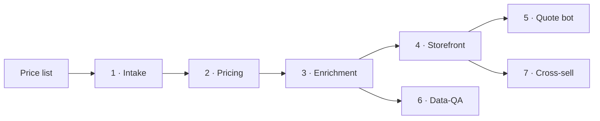

  

  
  
  

# bbs-ops

The plugin that keeps the Black Box Safety website running: clean a price list, load a contract, enrich a product, build a brand page, tune the quote bot, and merchandise related items — each the BBS way, every time.

Every capability maps to one stage of how a product becomes a page. Pick the agent whose job matches your task, or run a command that walks the whole flow.

**Jump to:** [The pipeline](#the-pipeline) · [Agents](#agents) · [Skills](#skills) · [Commands](#commands) · [The rules](#the-rules-that-always-hold) · [Contributing](#contributing)

## The pipeline

Three repos, one product truth: the Supabase products database (`bbs-database`) is the source, Shopify (`bbs-shopify`) renders it, and the quote bot (`bbs-quote-bot`) advises over a frozen snapshot plus live search. A database change reaches the storefront only after sync, and the bot only after a `gen-*.mjs` regen is committed. The `site-wiring-map` skill explains all of it.

## Agents

One owner per stage — reach for the one whose job matches your task.

| Agent | Owns |
|---|---|
| `catalog-intake` | Price-list cleaning, import-template mapping, ETL into the products database |
| `pricing-contracts` | Contract discount schedules, manufacturer eligibility, price modes |
| `product-enrichment` | Descriptions, image pipeline, variant-family rollups |
| `storefront-pages` | Shopify product cards, PDPs, brand pages, collections, metafields |
| `quote-bot` | Direct + Supply lanes, tuning, CA/CDCR bid forms |
| `data-qa` | Cross-stage data-quality audits, broken-image / mismatch hunts, missing-product triage |
| `cross-sell` | "Customers Also Bought" strip on cards + PDPs; adjacency-driven basket growth |

Cross-cutting reviewers:

| Agent | Role |
|---|---|
| `arthur` | Architecture — the deterministic/generative boundary, tool contracts, model routing, grounding, security |
| `tom` | Delivery & quality — acceptance criteria, prompt/knowledge governance, evals, production-readiness, onboarding |
| `business-review` | Customer-value review — does a change help a CA buyer quote or bid with less friction? |

## Skills

| Stage | Skill |
|---|---|
| Intake | `price-list-cleaner` |
| Pricing | `contract-discount-loader` |
| Enrichment | `family-rollup`, `image-pipeline` |
| Storefront | `product-page`, `brand-page-builder` |
| Quote bot | `le-lane-tuning`, `supply-lane-tuning`, `ca-form-filler`, `obs-form-filler`, `bbs-sourcing` |
| Cross-cutting | `site-wiring-map` |

Generic Shopify/Liquid reference skills (`shopify-plugin:*`, `liquid-skills:*`, `impeccable`, `firecrawl`, `windsor-ai`, `pr-review-toolkit`) are **linked, not copied** — they update on their own and never drift.

## Commands

| Command | Does |
|---|---|
| `/bbs-onboard` | Walk the pipeline + roster, wire the skill-bus guardrails, and point at `site-wiring-map`. Start here. |
| `/bbs-add-product` | Route "upload a product" through intake → pricing → enrichment → storefront. |
| `/bbs-new-brand` | New-manufacturer flow: import + contract eligibility + brand page. |
| `/bbs-review` | Run Arthur + Tom against recent changes; write findings back into the skills and docs. |

## The rules that always hold

Three doctrine inserts fire automatically when a relevant skill runs, so the rules apply even if you haven't read them:

- **Storefront** — BBS design tokens, cert/claim rules (no cross-jurisdiction credit; DVBE 2009473), MAP-not-contract pricing, RFQ page-flow.
- **Catalog** — import-template rules, contract eligibility and `is_restricted`, regenerate-don't-hand-edit for generated files.
- **Grounding** — the bot states only tool/knowledge facts (never invented prices); current model IDs (`claude-opus-4-8` / `claude-sonnet-5` / `claude-haiku-4-5`); cache the stable prefix; forms at session-end only.

## Contributing

This plugin improves like the site does:

1. Scope a change to one stage; write testable acceptance criteria (Tom's gate).
2. Keep it grounded — no path that lets the bot assert an ungrounded fact (Arthur's rule).
3. Run `/bbs-review` before shipping; fold any finding back into the relevant skill or `site-wiring-map`.
4. A finding that only lives in a chat is lost. Put it in a skill so the next person inherits it.

---

Part of the Black Box Safety operations plugin. No single point of failure by design.
