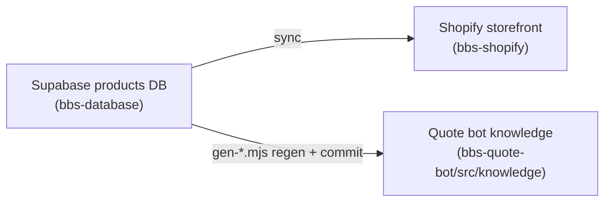

# BBS Site Wiring Map

Read this first. It is the front door to maintaining the BBS website.

## Three repos, one product truth

- **`bbs-database`** — the source of truth. Supabase Postgres `products` (+ `manufacturers`, `categories`), the ETL import pipeline, the contract-pricing subsystem (discount-off-MSRP by manufacturer, per contract), Firecrawl enrichment, variant-family rollups, and BC sync.
- **`bbs-shopify`** — the storefront. The "Field Manual" theme, product cards/PDPs, ~24 brand pages, `brand.*` + product metafields, the Supabase→Shopify sync, and the Sirv image CDN.
- **`bbs-quote-bot`** — the customer-facing quote + forms bot. React/Vite SPA (`src/components/BBSQuoteFormsBot.jsx`), Claude via the `/api/anthropic` proxy → Vercel AI Gateway, advisor knowledge in `src/knowledge/` (frozen snapshots of the DB, built by `scripts/gen-*.mjs`), CA form generators in `src/forms/`.

## How data flows (and the two gaps that trip people)

- A DB change does **not** appear on the storefront until the **Supabase→Shopify sync** runs.
- A DB change does **not** reach the bot until a **`gen-*.mjs` regen is run and committed**.
Forgetting either is the most common "why isn't my change showing up" cause.

## For each task: which skill, which agent

| I want to… | Skill | Agent |
|---|---|---|
| Clean/import a manufacturer price list | `price-list-cleaner` | `catalog-intake` |
| Apply/refresh a contract's discounts | `contract-discount-loader` | `pricing-contracts` |
| Build a variant family | `family-rollup` | `product-enrichment` |
| Fix/enrich descriptions or images | `image-pipeline` | `product-enrichment` |
| Change a product card or PDP | `product-page` | `storefront-pages` |
| Add a manufacturer brand page | `brand-page-builder` | `storefront-pages` |
| Tune the LE (Direct) lane | `le-lane-tuning` | `quote-bot` |
| Tune the Grainger (Supply) lane | `supply-lane-tuning` | `quote-bot` |
| Fill CA / CDCR bid forms | `bbs-sales:ca-form-filler` / `bbs-sales:obs-form-filler` | the sales desk, not this plugin |
| Source an RFQ from vendors | `bbs-sales:bbs-sourcing` | the sales desk, not this plugin |
| Add "Customers Also Bought" | (uses `product-page`) | `cross-sell` |
| Audit data quality | — | `data-qa` |
| Review architecture of a change | — | `arthur` |
| Review delivery/quality of a change | — | `tom` |
| Judge customer value of a change | — | `business-review` |

## External services (provided by the bbs-foundations plugin, referenced here)

The bot and these skills **reference** MCP connectors by name; they are provided by the `bbs-foundations` plugin, not bundled here. If a connector is not installed, the referencing skill **degrades gracefully** (it says the live lookup is unavailable and proceeds with what it has) — it never errors the session. Connectors: Grainger MCP, BBS KIt, Microsoft 365, Shopify, Supabase, ca-procurement-intel.

## The rules that always hold

The skill-bus injects three doctrine sets automatically when a relevant skill runs — see the plugin README. Storefront and catalog doctrine ship with this plugin. **Grounding doctrine ships with `bbs-foundations`** and fires on the two lane-tuning skills here; install that plugin too, or the quote-bot skills run without it. You do not have to memorize them; you do have to not fight them.
